<p align="center"></p>

# launch check for uniswap v4 hooks

one view call a hook makes before a buy: was this launch bundled, or held by a wallet ring?

it reads block-pinned facts an independent detector wrote to an [ERC-8470 Token Launch Observations](https://github.com/ethereum/ERCs/pull/2121) registry on robinhood chain, and compares them with limits the pool creator picks. no api, no oracle, no off-chain call.

- refuses a buy when more than `maxFirstBlockBps` of supply went in the token's first block
- refuses a buy when more than `maxFundingLinkedBps` sits with wallets that share a funding source
- sells always pass, so holders can always exit
- a token the detector has not observed yet follows `blockUnread` (fresh launches are observed ~20 minutes in)

## use it in a hook

```solidity
contract MyHook is BaseHook, LaunchCheckBlock {
    constructor(IPoolManager pm, LaunchCheck lc)
        BaseHook(pm)
        LaunchCheckBlock(lc, LaunchCheck.Policy({maxFirstBlockBps: 2500, maxFundingLinkedBps: 2000, blockUnread: false}))
    {}

    function _beforeSwap(address, PoolKey calldata key, SwapParams calldata params, bytes calldata)
        internal override returns (bytes4, BeforeSwapDelta, uint24)
    {
        if (params.zeroForOne) _launchCheck(Currency.unwrap(key.currency1)); // currency0 in, token out = a buy
        return (BaseHook.beforeSwap.selector, BeforeSwapDeltaLibrary.ZERO_DELTA, 0);
    }
}
```

a refused buy reverts with `LaunchCheckRefused(token, reason, value)`, e.g. `("first-block-share", 3356)`.

## live addresses (robinhood chain, 4663)

| | |
| --- | --- |
| ERC-8470 registry | `0x730e3c356299c9203cb042f6c0a9274aeabf9af3` ([verified](https://robinhoodchain.blockscout.com/address/0x730e3c356299c9203cb042f6c0a9274aeabf9af3?tab=contract)) |
| toll detector | `0x02593abff31f4e8ec1d5c2f297a347c51ef06e5c` |

## tests

fork tests against the live registry (no mocks):

```
forge test
[PASS] test_bundled_launch_refused()        33.56% of supply bought in block 1 -> refused
[PASS] test_clean_launch_allowed()          2.09% -> passes
[PASS] test_hook_reverts_buy_with_reason()
[PASS] test_limit_off_allows_bundled()
[PASS] test_unseen_token_follows_policy()
```

about 34k gas per check.

built by [toll](https://t0ll.xyz). MIT.
